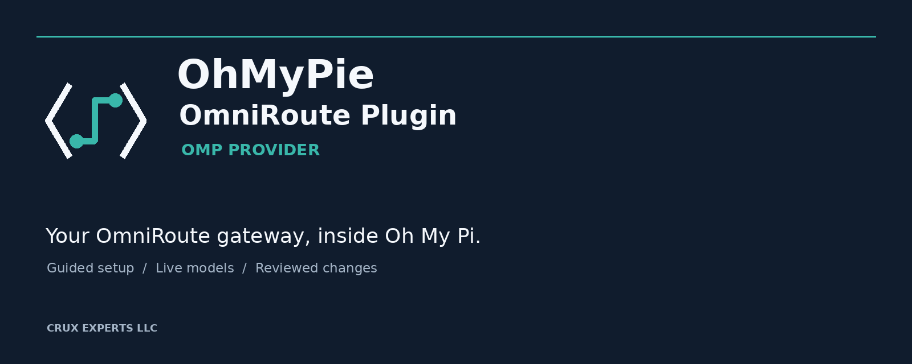
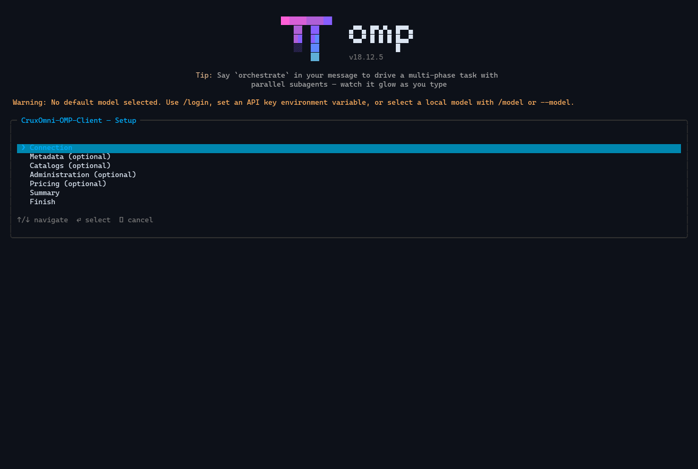

<p align="center">
  
</p>

<h1 align="center">OMP OmniRoute Provider</h1>

<p align="center">
  Bring your OmniRoute gateway into Oh My Pi with guided setup, live model discovery, and carefully reviewed administration.
</p>

<p align="center">
  <a href="https://github.com/CruxExperts/OMP-OmniRoute-Provider/releases/tag/v1.0.2">Download v1.0.2</a> ·
  <a href="docs/installation.md">Set up</a> ·
  <a href="docs/first-use.md">Everyday use</a> ·
  <a href="docs/administration.md">Administration</a> ·
  <a href="docs/reference/generated.md">Commands and capabilities</a>
</p>

<p align="center">
  <a href="https://github.com/CruxExperts/OMP-OmniRoute-Provider/actions/workflows/ci.yml"></a>
  <a href="https://github.com/CruxExperts/OMP-OmniRoute-Provider/releases/tag/v1.0.2"></a>
  <a href="LICENSE"></a>
</p>

## Your gateway, inside Oh My Pi

This repository contains an Oh My Pi (OMP) extension for an **existing OmniRoute server**. OMP hosts the client and its commands; OmniRoute continues to run the gateway, manage provider accounts, and route requests.

| Inside OMP | On the OmniRoute server |
| --- | --- |
| Guided connection setup and runtime credential handling through OMP's native credential storage | Gateway endpoint and provider accounts |
| Live model discovery and model selection | The models and routes available to the connected account |
| Optional metadata and source-backed pricing views | Inference and provider routing |
| A separate, guarded administration workflow | Server settings and management permissions |

Connect once, then work with the models your server actually exposes. Optional catalogs can add metadata to those live models; they do not create runnable model entries. Administration uses its own credential and requires an explicit review and confirmation for each supported change.

## Quickstart

Install the released GitHub tag through OMP's native plugin installer, then restart your OMP session:

```text
omp plugin install https://github.com/CruxExperts/OMP-OmniRoute-Provider#v1.0.2
```

In an interactive OMP terminal, run `/omniroute setup` and enter your OmniRoute endpoint and runtime API key in the guided prompts. The key is handled through OMP's native credential storage. If runtime environment variables are already active, setup asks before switching this OMP profile to a native connection; it never changes those variables. In OMP's `/login` provider selector, this provider appears as **Crux OmniRoute Provider**; model IDs and stored credentials continue to use `omniroute`. Metadata catalogs, pricing, and administration are optional.

List the models discovered from your connected server, then launch one by its live ID:

```text
omp models --json
omp --model omniroute/<live-model-id>
```

The [GitHub v1.0.2 release](https://github.com/CruxExperts/OMP-OmniRoute-Provider/releases/tag/v1.0.2) includes the versioned release assets. The command above installs from the GitHub source tag; it does not use the npm registry. See [installation and guided setup](docs/installation.md) for configuration and host-specific details.

## Develop from source

With Bun `1.4.2` or newer, install the locked development dependencies and link your checkout into OMP:

```bash
bun install --frozen-lockfile --ignore-scripts
omp plugin link "$PWD"
```

Restart OMP after changing a local plugin link. The development environment uses the declared OMP SDK versions; Bun is required for source development and package checks.

## Commands you will use

| Command | What it does |
| --- | --- |
| `/omniroute setup` | Connect or update optional settings |
| `/omniroute` | Check connection, model, and catalog status |
| `/omniroute refresh` | Refresh model discovery after server-side changes |
| `/omniroute-pricing [model-id]` | Inspect the configured seller-pricing data and its known or unknown fields |
| `/omniroute-admin status`, `enable`, `search`, `disable` | Check and manage the optional administration session |

The earlier `/cruxomni`, `/cruxomni-admin`, and `/cruxomni-pricing` commands
remain available as aliases.

See the [branding and compatibility policy](docs/branding.md) for the stable
provider identity and command-alias rules.

The [generated command reference](docs/reference/generated.md#registered-commands) is the source for the complete registered-command list.

## A guarded administration workflow

Administration is optional and remains bound to the exact endpoint you enable. Configure a separate management credential, check availability, and search the operation catalog. Before a supported change is sent, the client shows its target and a redacted preview; you confirm the specific change in OMP. Unqualified operations stay blocked, and an uncertain result must be reconciled before you try again.

Use this path when needed:

1. Read the [administration guide](docs/administration.md) and the current [capability inventory](docs/reference/generated.md#operation-inventory).
2. Run `/omniroute-admin status`, configure the separate credential in `/omniroute setup`, then run `/omniroute-admin enable` and `/omniroute-admin search`.
3. Review the target and preview in OMP before confirming. Run `/omniroute-admin disable` when finished.

Administration covers the qualified subset of OmniRoute's API; other operations remain unavailable until they meet the evidence requirements. The inventory is the current source for operation coverage and explains the limits of that qualification.

## Compatibility and release status

| | Current repository state |
| --- | --- |
| GitHub release and source version | `1.0.2` |
| Declared OMP host range | `>=18.12.2 <19` |
| Distribution | GitHub release assets and tagged GitHub source; no npm registry publication |

The declared OMP compatibility range is separate from the host versions and platforms with current release evidence. See the [generated compatibility reference](docs/reference/generated.md#version-and-compatibility) and [capability inventory](docs/reference/generated.md#operation-inventory) for the evidence and its limits. The [release guide](docs/reference/release.md) documents how those checks are maintained. The [`0.1.0` release notes](CHANGELOG.md#010--2026-09-20) describe the initial public release.

## Historical interface preview

This genuine OMP capture comes from an earlier development build and shows the former **CruxOmni** name. It illustrates the native setup menu; it is historical UI evidence, not a screenshot of the current release or proof of release qualification. The walkthrough cancels before any administration request.

<p align="center">
  
</p>

Read the [accessible walkthrough and text alternative](assets/native/omp-18.12.5/walkthrough.md) for context on all captured screens.

## Guides and project links

- [Installation and guided setup](docs/installation.md)
- [First use and everyday work](docs/first-use.md)
- [Administration](docs/administration.md)
- [Upgrade and removal](docs/upgrading.md)
- [Troubleshooting](docs/troubleshooting.md)
- [Generated commands, compatibility, and capability inventory](docs/reference/generated.md)
- [Security policy](SECURITY.md) · [Contributing](CONTRIBUTING.md) · [Changelog](CHANGELOG.md)
- [Releases](https://github.com/CruxExperts/OMP-OmniRoute-Provider/releases) · [Report an issue](https://github.com/CruxExperts/OMP-OmniRoute-Provider/issues)

---

<p align="center">
  © 2026 <a href="https://www.cruxexperts.com/">Crux Experts LLC</a> · Source code and documentation: <a href="LICENSE">MIT License</a> · Visual assets: <a href="ASSET_LICENSE.md">separate project-reference license</a>
</p>
