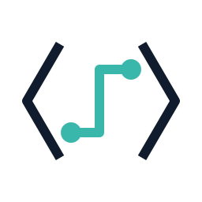
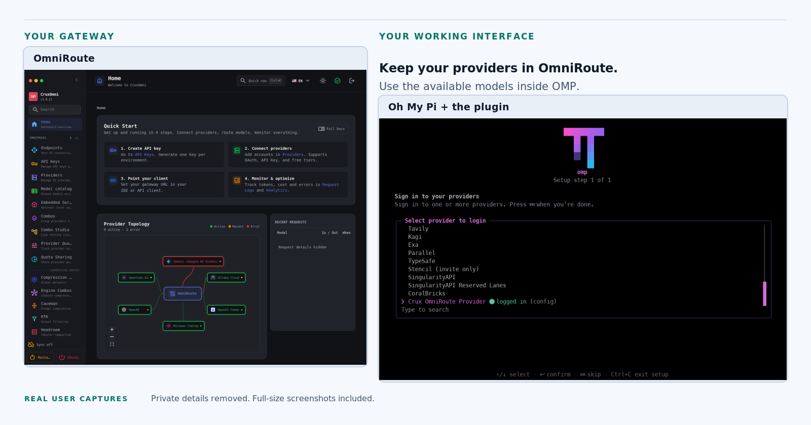

<div align="center">

<picture>
  <source media="(prefers-color-scheme: dark)" srcset="assets/brand/marketing/product-mark-dark.svg">
  
</picture>

# OMP OmniRoute Provider

### Your OmniRoute models. Right inside Oh My Pi.

Connect the AI setup you already have to the coding assistant you want to use.

**[Get started](#get-started)** · **[See the real screens](docs/visual-walkthrough.md)** · **[Get help](#need-a-hand)**

[](https://github.com/CruxExperts/OMP-OmniRoute-Provider/releases/tag/v1.0.2)
[](LICENSE)
[](https://github.com/can1357/oh-my-pi)

<picture>
  <source media="(prefers-color-scheme: dark)" srcset="assets/brand/marketing/showcase-dark.png">
  <source media="(prefers-color-scheme: light)" srcset="assets/brand/marketing/showcase-light.png">
  
</picture>

<sub>Real, user-supplied screens. Personal details removed. [View full-size screenshots and capture notes.](docs/visual-walkthrough.md)</sub>

</div>

## Keep your setup. Connect your tools.

You have already connected your AI providers in OmniRoute. You should not have to repeat that setup just to use them in Oh My Pi.

**OMP OmniRoute Provider is the plugin that connects the two.** Enter your gateway address and access key through guided prompts, choose a model your gateway makes available, and work inside OMP. Your provider accounts and routing stay in OmniRoute.

You do not need to edit configuration files for the normal guided connection. Install the plugin, restart OMP, and follow the setup prompts.

### One connection instead of another round of provider setup

Point OMP at your existing gateway. The plugin uses the models exposed by that gateway, rather than asking you to configure every underlying provider again inside OMP.

### A model list that comes from your gateway

Discover the chat models available to your connection. When you change what the gateway exposes, refresh the list in OMP. Optional model information can enrich those entries without inventing models you cannot actually run.

### Start with the essentials. Leave the rest for later.

Connect, choose a model, and get to work. Additional model information, pricing views, and administration are optional. You do not need to enable them to use the basic connection.

## What connects to what?

| Part | Its job |
| --- | --- |
| **Oh My Pi, or OMP** | The AI coding assistant you use in your terminal. |
| **OmniRoute** | The separate gateway where your AI providers and routing are configured. |
| **This plugin** | The connection between OMP and that gateway, with guided setup and model discovery. |

**This is an OMP plugin, not an OmniRoute server.** It does not install the gateway or create provider accounts for you. It connects to the gateway you already use, whether you run it yourself or have access to one managed for you.

## Get started

### Before you begin

Have **OMP installed**, **a working OmniRoute gateway**, and **the gateway's address and runtime API key** ready. The runtime key is the access key OMP will use for model requests. It is not automatically an administration credential.

New to either tool? Start with [Oh My Pi](https://github.com/can1357/oh-my-pi) and [OmniRoute](https://github.com/cheaper-inference/OmniRoute), then return here to connect them. The declared OMP compatibility range for this plugin is `>=18.12.2 <19`; see [compatibility notes](#compatibility-and-release-notes) for the distinction between that range and tested releases.

### 1. Install the plugin

Run this in your normal terminal, **outside an OMP conversation**:

```sh
omp plugin install https://github.com/CruxExperts/OMP-OmniRoute-Provider#v1.0.2
```

Close and restart OMP after installation. This command installs the tagged GitHub source; there is no npm-registry installation step for this release.

### 2. Connect your gateway

Inside OMP, enter:

```text
/omniroute setup
```

Open **Connection**. Enter your gateway address and its runtime API key. The key prompt is masked. Setup checks the connection, verifies the key, and checks the gateway's live model list before activating the connection.

Use the address for your own gateway. The example `https://llm.example.com` is only an example, not a service included with this plugin. For an address that intentionally uses HTTP, include `http://` explicitly; see the [connection guide](docs/installation.md#guided-setup) for details.

Leave the optional sections alone for your first connection. You can return to them later.

<details>
<summary><strong>Already using OMP's /login menu?</strong></summary>

Look for **Crux OmniRoute Provider** in the provider selector. That is the name shown inside OMP; **OMP OmniRoute Provider** is the project's name.


The screenshots show this native `/login` path. The recommended `/omniroute setup` command opens the plugin's own guided setup instead.

OMP may briefly display “Starting OAuth flow…” in its native login screen. This provider still uses your gateway's API key; that generic host message does not mean you need a browser-based OAuth login. [More about that message.](docs/troubleshooting.md#omp-displays-generic-oauth-wording)

</details>

### 3. Choose a model and start working

Use OMP's model selector to choose one of the models discovered from your OmniRoute connection. The available choices depend on what your gateway and credentials expose.

Check the connection at any time:

```text
/omniroute
```

You now have OMP as your working interface and OmniRoute handling the gateway side. Choose your task and continue in OMP.

<details>
<summary><strong>Prefer choosing a model from the terminal?</strong></summary>

List the models from your normal terminal:

```sh
omp models --json
```

Then start OMP with the full model selector returned by that list. The following shows the format; replace `<live-model-id>` with a real discovered model ID rather than pasting the placeholder literally:

```text
omp --model omniroute/<live-model-id>
```

[Read the complete model-selection instructions.](docs/installation.md#select-a-live-model)

</details>

**Stuck at a step? [Open the troubleshooting guide](docs/troubleshooting.md).**

## See what you will use

These are real screens from a user-provided OMP session, not recreated interfaces. Terminal title bars and outer edges have been removed. The full terminal viewport is preserved in each downloadable screenshot, with only identified privacy areas edited.


*The native sign-in screen asks for your gateway address, followed by its API key. The example addresses shown are guidance, not preconfigured connections.*

[See all six OMP screens, the gateway screen, and full-size sanitized captures →](docs/visual-walkthrough.md)

## Everyday use, without a command manual

You only need a few plugin commands for routine work. Enter these **inside OMP**.

| You want to… | Use this |
| --- | --- |
| Connect or change setup options | `/omniroute setup` |
| Check the current connection and model information | `/omniroute` |
| Refresh models after changes in OmniRoute | `/omniroute refresh` |
| Inspect optional configured pricing information | `/omniroute-pricing` |

The earlier `/cruxomni`, `/cruxomni-admin`, and `/cruxomni-pricing` names remain supported aliases. You do not need to rename saved credentials or start over.

## More control when you need it

### Optional information about your models

Enable optional catalogs to add available model details to the models your gateway already exposes. Catalogs do not add runnable models, install AI models on your computer, or replace the gateway's live model list.

### Pricing with the gaps left visible

An optional source-backed pricing view can show information from a configured pricing file. Missing prices remain unknown, not “free.” This is not a promise of live billing, a spending limit, or an automatically cheaper route.

### Selected administration from inside OMP

For users managing their own gateway, the plugin also offers a separate administration workflow. Supported changes are previewed and require explicit confirmation. Administration uses a separate management credential; installing the plugin or signing in for chat does not automatically grant permission to change the server.

**Administration is optional and covers selected operations, not the entire OmniRoute dashboard.** Read the [administration guide](docs/administration.md) and [current operation inventory](docs/reference/generated.md#operation-inventory) before enabling it.

<details>
<summary><strong>Administration entry points</strong></summary>

Enter these inside OMP when you are ready to use the separate administration workflow:

```text
/omniroute-admin status
/omniroute-admin enable
/omniroute-admin search
/omniroute-admin disable
```

Configure the separate credential through setup before enabling administration. Check an operation's availability, inspect its preview, and confirm only the change you intend. An uncertain response is not proof of success; follow the guide's recovery instructions rather than blindly repeating it.

</details>

## Your connection, explained plainly

Your runtime API key is handled through OMP's native credential storage after successful connection checks. Optional metadata and administration credentials can be kept for the current session or remembered in OMP's credential store, according to the option you choose.

OMP sends model requests through the gateway you configure. Which providers handle those requests depends on your OmniRoute setup. Self-hosting a gateway does not, by itself, mean that every model runs locally.

[Read what is stored](docs/installation.md#what-is-stored) · [Read the security policy](SECURITY.md)

## Common questions

<details>
<summary><strong>Do I need to be a developer?</strong></summary>

You do not need to edit the plugin's code or hand-write configuration files for the normal setup. You do need OMP, access to an already-working gateway, and the ability to run the install command. The guided prompts handle the connection details.

</details>

<details>
<summary><strong>Is it free?</strong></summary>

The plugin's source code and documentation are MIT licensed. Using AI models, provider accounts, and hosting may carry their own costs. The visual assets have a separate project-reference display license.

</details>

<details>
<summary><strong>Does this replace OmniRoute or change my provider setup?</strong></summary>

No. OmniRoute remains the separate gateway. Your provider accounts and routing remain there. The plugin brings the models available to that connection into OMP. Optional administration is a separate workflow that you deliberately enable.

</details>

<details>
<summary><strong>Why does the menu say “Crux OmniRoute Provider”?</strong></summary>

That is the plugin's label in OMP's login menu. The public project name is OMP OmniRoute Provider. The underlying provider ID remains `omniroute`, which preserves the existing model and credential identity.

</details>

<details>
<summary><strong>Why is a model missing?</strong></summary>

Run `/omniroute refresh`, then check the gateway and the key you connected with. Only compatible chat models returned by the gateway's live catalog become selectable. A model appearing in an optional information catalog does not make it available to your connection.

</details>

<details>
<summary><strong>Can I use local models?</strong></summary>

The relevant question is whether your gateway exposes the model through a supported chat connection. The plugin does not download model weights or turn every locally installed model into an OMP option. Check the live model list and the gateway configuration.

</details>

## Compatibility and release notes

| Item | Reference for this README |
| --- | --- |
| Tagged plugin installation | `v1.0.2` |
| Declared OMP range | `>=18.12.2 <19` |
| Distribution | GitHub release assets and tagged GitHub source |
| Optional administration | Availability is defined by the current operation inventory |

A declared version range is not the same as a completed test matrix. The supplied startup screenshot displays OMP **18.12.6**, while the repository's generated reference lists **18.12.2 and 18.12.5** as its requested host test matrix. A screenshot is not a substitute for release verification. The gateway screenshot displays **3.8.51** and a customized label; it is an illustration of that user's setup, not a claim to show the latest OmniRoute release.

[Compatibility reference](docs/reference/generated.md#version-and-compatibility) · [Changelog](CHANGELOG.md) · [Upgrade or remove the plugin](docs/upgrading.md)

## Need a hand?

Start with the [installation guide](docs/installation.md), [everyday-use guide](docs/first-use.md), or [troubleshooting guide](docs/troubleshooting.md).

For a problem you cannot resolve, [open an issue](https://github.com/CruxExperts/OMP-OmniRoute-Provider/issues/new/choose). Include the plugin version, OMP version, the command you used, and the sanitized error message. Remove keys, cookies, personal addresses, account details, and private workspace information before posting.

Use the process in [SECURITY.md](SECURITY.md) for sensitive security reports. [Support information](SUPPORT.md) explains the project's support channels.

<details>
<summary><strong>For contributors and maintainers</strong></summary>

Start with [CONTRIBUTING.md](CONTRIBUTING.md), the [generated command reference](docs/reference/generated.md), and the [branding and naming policy](docs/branding.md).

Source development requires Bun `>=1.4.2`. The normal user installation above is different from linking a development checkout:

```sh
bun install --frozen-lockfile --ignore-scripts
omp plugin link "$PWD"
```

Restart OMP after changing a development link. Keep public display names separate from package IDs, command aliases, and stored-credential identities.

</details>

---

<div align="center">

### Keep the gateway you trust. Use the client you choose.

**[Connect OMP to OmniRoute](#get-started)**

Built and maintained by **[Crux Experts LLC](https://www.cruxexperts.com/)**.


<sub>Independent plugin for Oh My Pi and OmniRoute. No upstream endorsement is implied.</sub>

<sub>[Source and documentation: MIT](LICENSE) · [Visual assets: separate project-reference license](ASSET_LICENSE.md) · [Third-party notices](THIRD_PARTY_NOTICES.md)</sub>

</div>
