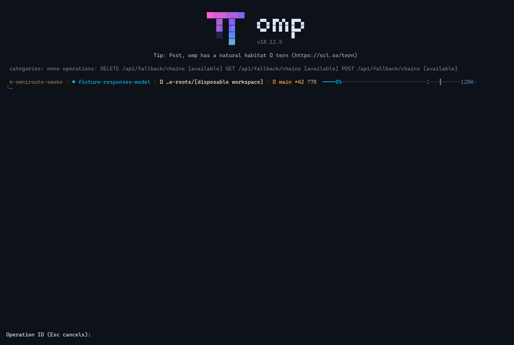
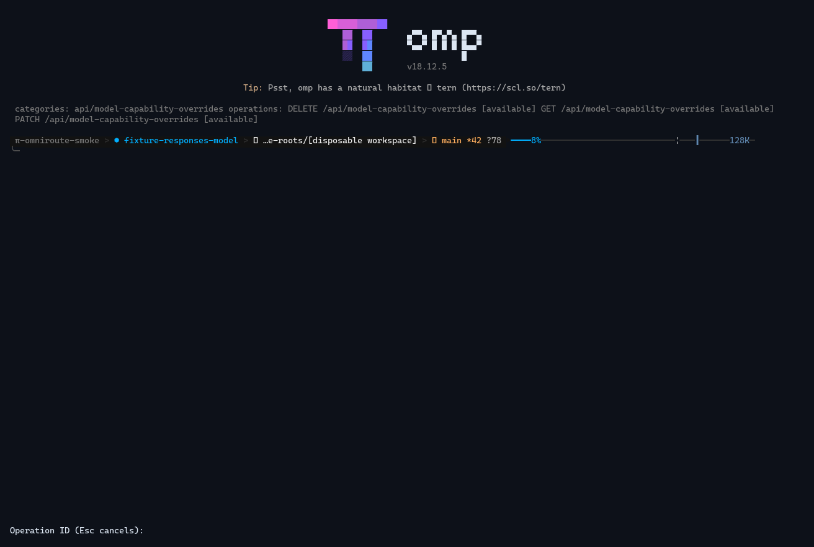

# Native OMP setup and administration walkthrough

This walkthrough was captured from a real Oh My Pi (OMP) 18.12.5 process running the built CruxOmni plugin in an isolated native Linux x64 terminal. The terminal UI was mirrored from its Bun PTY into a private tmux 3.4 server, then rendered from captured terminal cells. It was not drawn from the fixture illustrations and it was not captured from a desktop.

The setup screenshot shows the actual setup menu: Connection, Metadata (optional), Catalogs (optional), Administration (optional), Pricing (optional), Summary, and Finish. The setup flow was cancelled before any credentials or configuration were entered.

The administration screenshots show the actual `/cruxomni-admin` browser after enabling administration in a disposable private profile. The six selected descriptors from two families appeared as available in the captured source snapshot: three fallback-chain operations and three model-capability-override operations. They are representative screens, not a complete operation inventory. Current release eligibility may differ; see [the captured provenance](provenance.json) and [the current eligibility inventory](../../../contracts/release-eligibility.json). Each screen was cancelled at the operation prompt. No administration operation was dispatched, and the local fixture server was not treated as a live OmniRoute server or as an oracle for management behavior.

## Screenshots

## Video and text alternative

The short video has no audio. It holds three selected genuine screens for two seconds each, in this order: setup wizard, fallback-chain browser, model-capability browser. The descriptions above and this transcript provide a static text alternative.

The native UI confirms the setup menu, then displays the fallback-chain operation list and the model-capability-override operation list. Each shown descriptor was marked `[available]` in this captured source snapshot; later eligibility may differ. The human-facing operation prompt appears next; the walkthrough sends Escape and makes no request. This is evidence of what the client UI rendered in the private, disposable fixture run. It does not establish a live server response or production account result.

Copyright © 2026 Crux Experts LLC. https://www.cruxexperts.com/

Private asset. Property of Crux Experts LLC. Use, reproduction, modification, distribution, or publication without prior written permission is prohibited.

The terminal interface shown is Oh My Pi (OMP) 18.12.5, Copyright (c) 2025 Mario Zechner, Copyright (c) 2025-2026 Can Bölük, and Copyright (c) 2026 Stencil Labs, Inc.; it is licensed under the MIT License. The rendering font is CaskaydiaCove Nerd Font Mono, Copyright (c) 2019-Present Microsoft Corporation, under SIL Open Font License 1.1. Crux Experts LLC owns only this captured and rendered media artifact.
