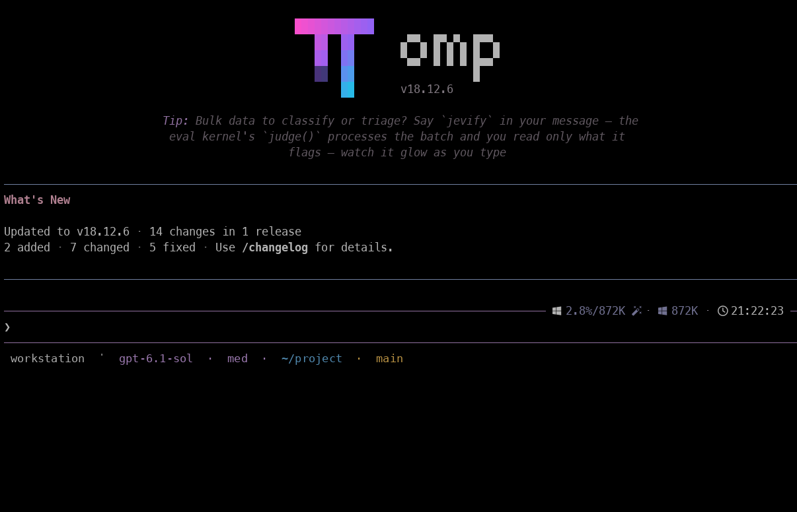
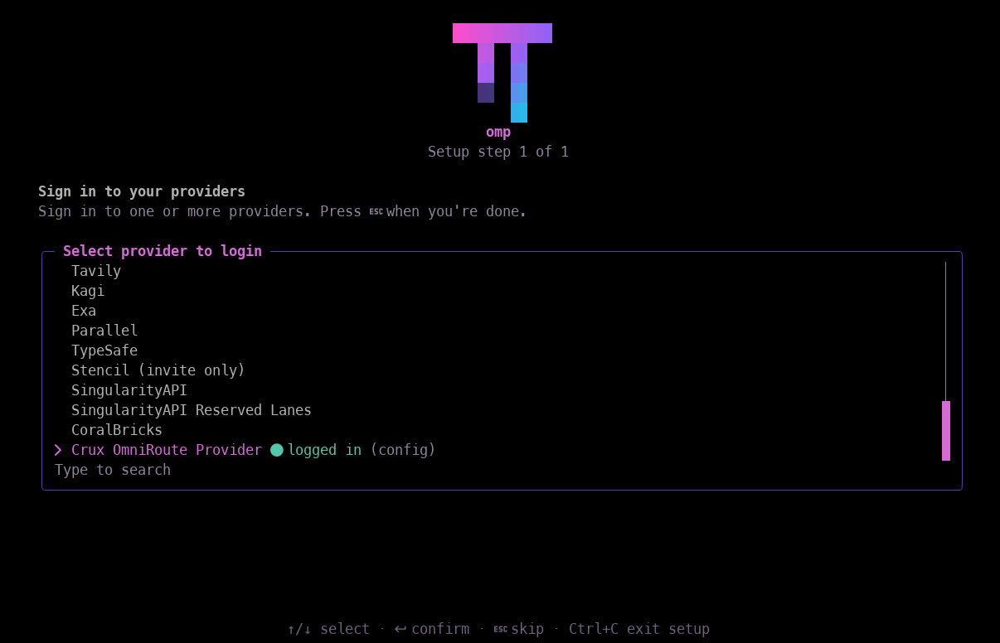
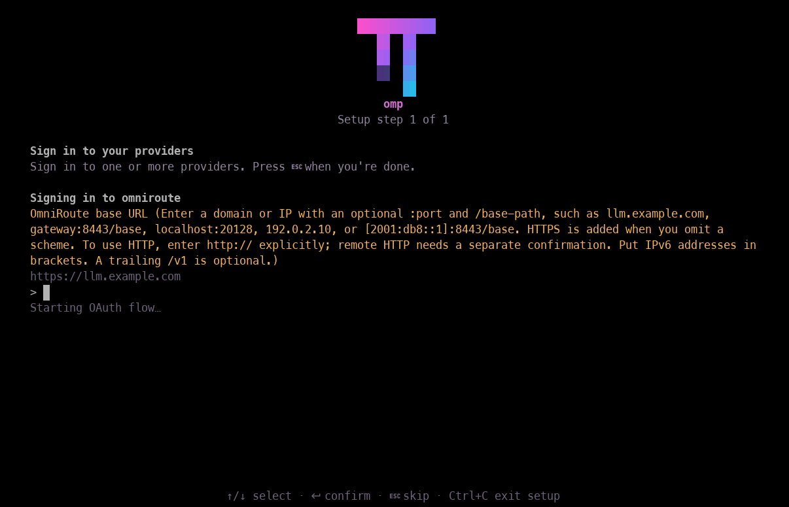
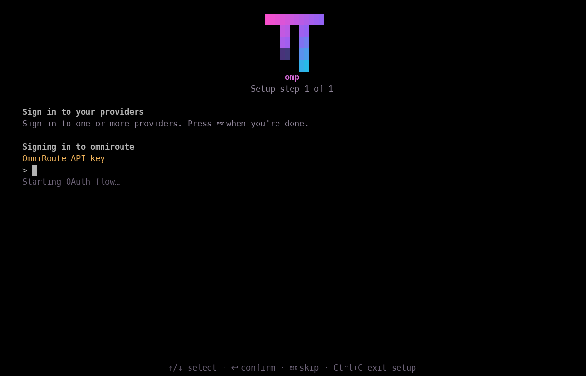
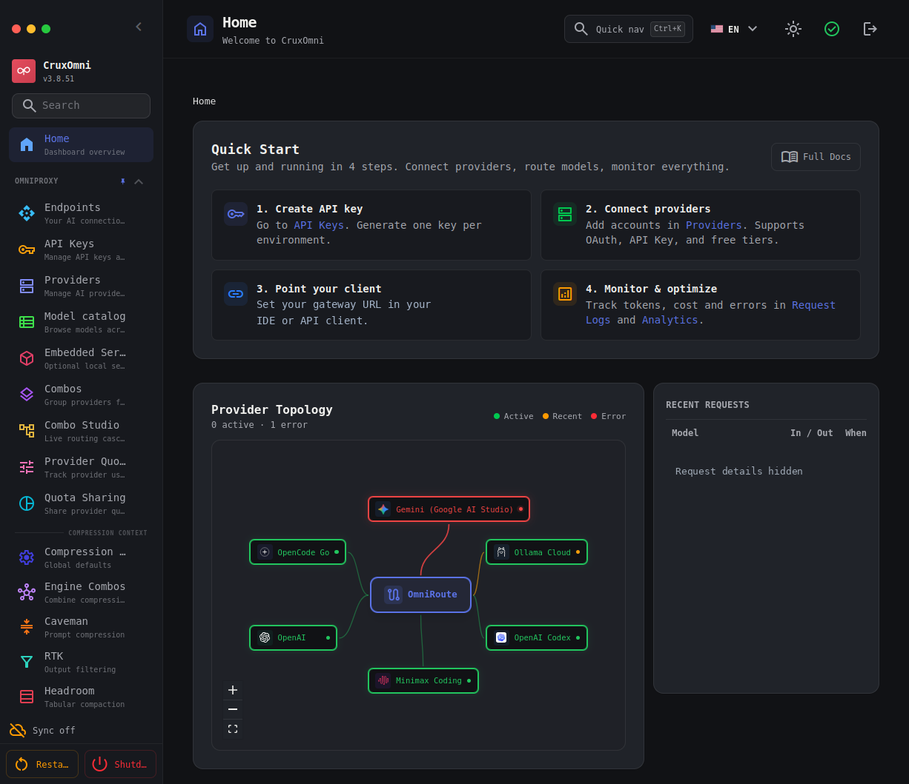

# OMP and OmniRoute: the real screens

These screenshots were supplied by a user of the plugin. They show the real interfaces, not simulated success screens or generated reconstructions. Click any image to open its full-size sanitized PNG.

The normal recommended setup starts with `/omniroute setup`. The login screenshots below show the alternative native OMP `/login` path, where the plugin appears as **Crux OmniRoute Provider**. These are two entry points, not identical screens.

## 1. Open OMP

The first screen shows the `omp` command in the shell. The identity has been replaced with `user@workstation`, and the workspace label is generic.

## 2. The OMP startup screen

This capture displays OMP **18.12.6**. The host and private workspace/session details in the status area have been anonymized. The plugin package version is not visible in this image.

<strong>Optional: OMP's splash screen</strong>

This is OMP's own terminal artwork. It is not a Crux Experts logo or evidence of a successful gateway connection.

## 3. Find the plugin in OMP

In OMP's native `/login` provider selector, look for **Crux OmniRoute Provider**. The captured session shows a logged-in indicator. That reflects this session's state; a new installation will not already be signed in.

## 4. Enter your gateway address

Use the address of your existing OmniRoute gateway. Example domains and addresses in the prompt are documentation examples, not a gateway bundled with the plugin. The screenshot input is empty.

## 5. Enter the runtime API key

Use the runtime key for your gateway. The screenshot shows an empty key prompt; no key is published.

The generic “Starting OAuth flow…” line belongs to OMP's login interface. This plugin uses an API key for this connection. The plugin-specific setup wizard provides API-key wording. [See the explanation.](troubleshooting.md#omp-displays-generic-oauth-wording)

## 6. The gateway stays in OmniRoute

The separate dashboard is where this user manages their gateway. This capture visibly shows **3.8.51** and a customized **CruxOmni** display label. It is not a claim about the latest upstream version, the plugin version, or a configuration every user will have. Its provider names are examples from this user's setup, not a guaranteed compatibility list.

## Capture treatment

The six OMP images preserve the complete **1206 × 776** terminal viewport from the supplied **1212 × 841** originals. Only the 65-pixel title/tab area and six-pixel right scrollbar were cropped away. No screenshot master was enlarged, stretched, reflowed, sharpened, or regenerated.

The gateway screenshot preserves a **1226 × 1059** page viewport after the 118-pixel browser frame is removed. Its private gateway address and request activity are masked and replaced with neutral wording.

Only defined privacy regions were edited. Those edits replace the shell identity, private status metadata, private gateway address, and recent request details. Public example domains in the OMP setup instructions are retained. The capture set is illustrative user evidence, not a release certification or a test report.

These images are privacy-edited derivatives, not the original unredacted uploads. The private originals are deliberately not distributed. Parent product names and third-party interface rights remain unchanged.

[Back to getting started](../README.md#get-started)
